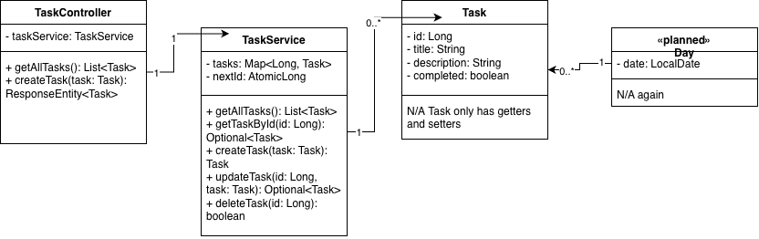
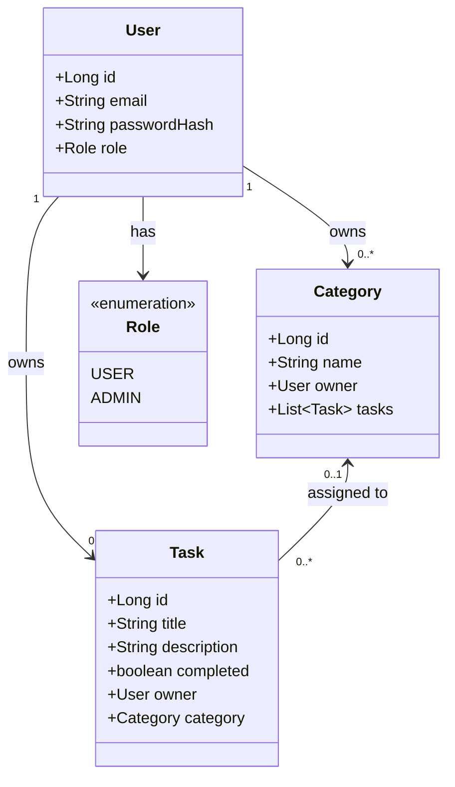

# DayBuilder Class Diagram

The original class diagram is shown below.

## Data model (DAYB-88)

- `users` table: `email` is unique; `role` is stored as text (`@Enumerated(EnumType.STRING)`).
- `tasks.user_id` is a foreign key to `users.id` (`@ManyToOne @JoinColumn(name = "user_id")`).
- `@JsonIgnore` on `User.tasks`, `User.passwordHash` and `Task.owner` prevents infinite JSON loops and keeps password hashes out of API responses.
